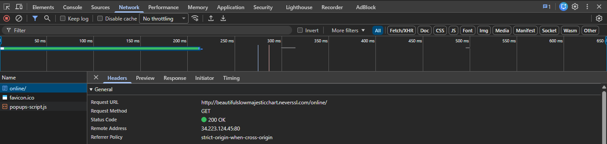

# Informe de Auditoría de Red Wi-Fi Insegura

## Introducción

En esta práctica se analiza el riesgo de navegar por una red Wi-Fi pública utilizando un sitio web que funciona mediante HTTP. El objetivo es identificar qué información queda visible durante una solicitud web sin cifrado, comprender los riesgos asociados y explicar cómo una VPN puede proteger el tráfico mediante cifrado, encapsulamiento y un túnel seguro.

## Sitio analizado

**Sitio visitado:** http://neverssl.com

NeverSSL utiliza HTTP sin cifrado, por lo que la comunicación entre el navegador y el servidor puede ser observada con mayor facilidad por terceros que tengan acceso al tráfico de red.

## Evidencia observada

Para realizar la exploración se abrió el sitio en el navegador y se utilizaron las herramientas de desarrollador mediante **F12 > Network / Red**.

Al recargar la página se pudieron observar los siguientes datos:

- **Protocolo:** HTTP
- **Método:** GET
- **Host observado:** beautifulslowmajesticchart.neverssl.com
- **URL solicitada:** http://beautifulslowmajesticchart.neverssl.com/online/
- **Código de respuesta:** 200 OK
- **Dirección remota:** 34.223.124.45:80
- **Headers:** visibles en la solicitud
- **User-Agent:** visible dentro de los encabezados enviados por el navegador

### Captura de evidencia

## Análisis técnico

### 1. ¿Qué protocolo utiliza el sitio?

El sitio utiliza **HTTP**. A diferencia de HTTPS, HTTP no cifra por sí mismo el contenido de la comunicación entre el cliente y el servidor. Esto significa que la información enviada puede quedar expuesta si un tercero logra observar el tráfico de red.

### 2. ¿Qué información puede observarse durante la solicitud?

Durante una solicitud HTTP pueden observarse distintos elementos, entre ellos:

- El **host** al que se conecta el navegador.
- La **URL** solicitada.
- El **método HTTP**, por ejemplo `GET`.
- Los **headers** enviados.
- El **User-Agent** del navegador.
- Otros metadatos de la solicitud.

Esto demuestra que HTTP ofrece poca privacidad frente a alguien que pueda capturar tráfico dentro de una red compartida.

### 3. ¿Qué riesgos existen al navegar mediante HTTP desde una red Wi-Fi pública?

En una red Wi-Fi pública un atacante cercano podría intentar capturar tráfico mediante técnicas de **sniffing** o posicionarse entre el usuario y el router mediante un ataque **Man-in-the-Middle**.

Si la comunicación utiliza HTTP, el atacante podría observar información como:

- Sitios y rutas visitadas.
- Cabeceras HTTP.
- Datos enviados sin cifrado.
- Información de formularios que no esté protegida.
- Metadatos sobre el navegador y el dispositivo.

También existe el riesgo de conectarse a una red falsa o **Evil Twin**, diseñada para imitar a la red legítima de una cafetería, aeropuerto o establecimiento público.

## ¿Cómo ayuda una VPN?

Una VPN crea un **túnel seguro** entre el dispositivo y el servidor VPN. El tráfico se protege mediante **cifrado** y **encapsulamiento**, por lo que los datos viajan dentro de una conexión protegida antes de salir hacia Internet.

En una red Wi-Fi pública, esto aporta varias ventajas:

- **Cifrado:** dificulta que otros usuarios de la red puedan leer el contenido capturado.
- **Encapsulamiento:** los paquetes originales viajan protegidos dentro del túnel VPN.
- **Túnel seguro:** el tráfico entre el dispositivo y el servidor VPN queda aislado de observadores locales.
- **Privacidad:** reduce la cantidad de información que un atacante conectado a la misma red puede inspeccionar directamente.

Una VPN no reemplaza HTTPS. Siempre que sea posible, se debe utilizar HTTPS además de la VPN para mantener cifrado de extremo a extremo entre el navegador y el sitio web.

## 3 Reglas de Oro para usar redes Wi-Fi públicas

### Regla 1 — Priorizar HTTPS

No ingresar credenciales, datos bancarios ni información sensible en sitios que utilicen HTTP. Verificar siempre que la conexión utilice HTTPS.

### Regla 2 — Utilizar una VPN en redes no confiables

Al conectarse a una red pública, utilizar una VPN confiable para crear un túnel cifrado y reducir el riesgo de intercepción del tráfico.

### Regla 3 — Verificar la red antes de conectarse

Confirmar el nombre correcto de la red con el establecimiento y evitar conectarse automáticamente a redes desconocidas o con nombres similares, ya que podrían ser redes **Evil Twin**.

## Conclusión

La práctica permite observar que una conexión HTTP expone información que puede ser visible para terceros con acceso al tráfico de una red compartida. En una Wi-Fi pública, esto aumenta el riesgo de sniffing, ataques Man-in-the-Middle y redes Evil Twin.

Para reducir estos riesgos se recomienda utilizar HTTPS, conectarse mediante una VPN cuando la red no sea confiable y verificar siempre la legitimidad del punto de acceso antes de conectarse. La combinación de cifrado, buenas prácticas y verificación de la red mejora significativamente la seguridad y privacidad durante la navegación.